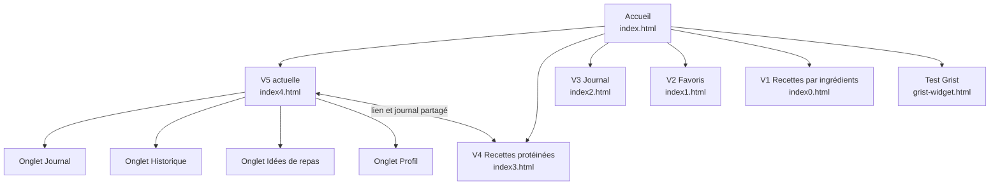
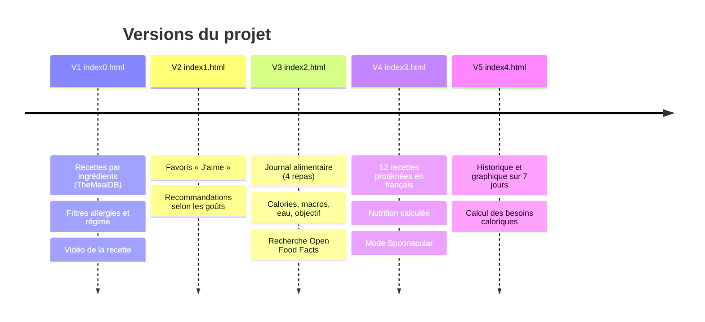

# Journal alimentaire — accueil de la documentation

Site web de suivi de l'alimentation, inspiré de MyFitnessPal et Yazio : on note ce qu'on mange, le site calcule les calories et les macronutriments (protéines, glucides, lipides), les compare à un objectif quotidien et affiche l'historique de la semaine. Des recettes françaises riches en protéines servent d'inspiration.

Projet du cours *Introduction à la programmation* (Master Numérique, Enjeux et Technologies, Université Paris 8).

- Site en ligne : <https://sami-le.github.io/generateur-de-recettes/>
- Code source : <https://github.com/Sami-Le/generateur-de-recettes>

## Sommaire de la documentation

| Document | Pour qui | Contenu |
|---|---|---|
| [accueil.md](accueil.md) | Tout le monde | Présentation, versions, plan du site |
| [utilisateur.md](utilisateur.md) | Utilisateurs du site | Comment tenir son journal, lire l'historique, calculer ses besoins, trouver des recettes |
| [technique.md](technique.md) | Développeurs | Architecture, données, services externes, calculs |
| [installation.md](installation.md) | Développeurs | Lancer le site en local, le publier, utiliser le script des vidéos |

## Le problème traité

Suivre ce qu'on mange est fastidieux : il faut chercher les valeurs nutritionnelles de chaque aliment, faire les additions et savoir combien on devrait manger. Le site automatise la recherche des aliments (base Open Food Facts), le calcul des calories et des macros, le suivi sur 7 jours et l'estimation des besoins caloriques.

## Plan du site

## Évolution du projet

Chaque version reste accessible dans son propre fichier : le cours évalue la capacité à faire évoluer le projet.

| Version | Fichier | Nouveautés |
|---|---|---|
| V1 | `index0.html` | Recettes par ingrédients (français ou anglais), filtres allergies et régime, vidéo |
| V2 | `index1.html` | Bouton « J'aime » et recommandations personnalisées stockées dans le navigateur |
| V3 | `index2.html` | Journal alimentaire : 4 repas, recherche d'aliments, code-barres saisi, calories, macros, eau, objectif |
| V4 | `index3.html` | Recettes protéinées en français (`recettes.json`), filtres, vidéos YouTube, mode Spoonacular |
| V5 | `index4.html` | Onglet Historique (7 jours, graphique, tableau) et calcul des besoins caloriques dans le Profil |

## Technologies

Site statique hébergé sur GitHub Pages : HTML, CSS et JavaScript, sans serveur ni base de données. Les données de l'utilisateur restent dans son navigateur (localStorage). Détails dans [technique.md](technique.md).

## Avertissement

Les valeurs nutritionnelles et les besoins calculés sont des **estimations indicatives**. Le site ne remplace pas l'avis d'un médecin ou d'un diététicien.
