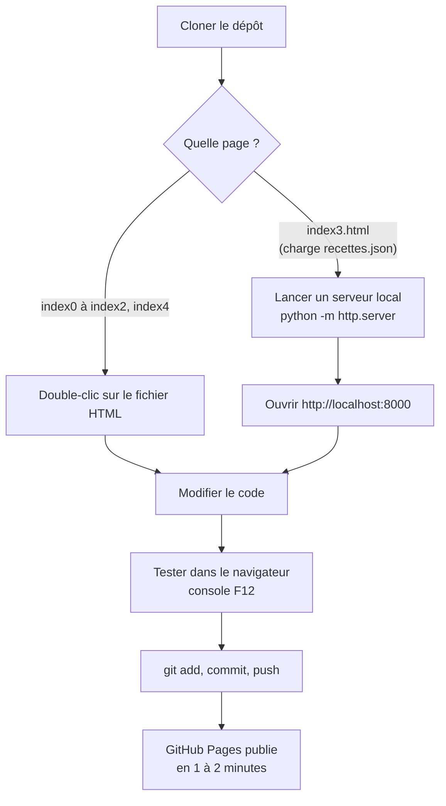

# Installation

Retour à l'[accueil de la documentation](accueil.md). Fonctionnement interne : [technique.md](technique.md).

Le site n'a pas besoin d'installation pour être utilisé : il suffit d'ouvrir <https://sami-le.github.io/generateur-de-recettes/>. Cette page explique comment le faire tourner sur son ordinateur, le publier et utiliser le script des vidéos.

## Prérequis

| Outil | Pour quoi faire | Obligatoire ? |
|---|---|---|
| Un navigateur récent (Firefox, Chrome, Edge, Safari) | Utiliser et tester le site | Oui |
| [Git](https://git-scm.com/) | Récupérer et publier le code | Oui pour développer |
| [Python 3](https://www.python.org/) | Serveur local et script des vidéos | Pour `index3.html` et le script |
| Une clé YouTube Data API | Script des vidéos | Seulement pour le script |

## Étapes



### 1. Récupérer le code

```bash
git clone https://github.com/Sami-Le/generateur-de-recettes.git
cd generateur-de-recettes
```

### 2. Lancer le site en local

Les pages `index0.html`, `index1.html`, `index2.html` et `index4.html` s'ouvrent directement par un double-clic.

`index3.html` charge `recettes.json` avec `fetch`, ce que le navigateur bloque pour un fichier ouvert directement (`file://`). Il faut un petit serveur local, lancé depuis le dossier du projet :

```bash
python -m http.server 8000
```

Puis ouvrir <http://localhost:8000/> (ou <http://localhost:8000/index3.html>). `Ctrl + C` arrête le serveur.

### 3. Déboguer

Ouvrir les outils de développement (F12 ou clic droit → Inspecter), onglet **Console** : les erreurs JavaScript et les `console.log` y apparaissent. L'onglet **Application** (Chrome) ou **Stockage** (Firefox) → *Local Storage* montre les données enregistrées (`journalData`, `journalGoal`, `profilUtilisateur`…).

### 4. Publier avec GitHub Pages

GitHub Pages est activé sur la branche `main`, à la racine du dépôt (réglage : *Settings → Pages → Deploy from a branch*). Chaque `push` met le site à jour :

```bash
git add index4.html
git commit -m "Description de la modification"
git push origin main
```

Pour une nouvelle version, créer un nouveau fichier `indexN.html` (sans modifier les précédents) et ajouter son lien dans `index.html`.

### 5. Ajouter les vidéos YouTube aux recettes (facultatif)

Le script `scripts/trouver_videos.py` cherche une vidéo pour chaque recette de `recettes.json` qui n'en a pas encore, et ajoute son identifiant, son titre, sa chaîne et sa miniature.

1. Créer une clé « YouTube Data API v3 » dans la [Google Cloud Console](https://console.cloud.google.com/).
2. La passer en variable d'environnement (elle ne doit **jamais** être écrite dans le code ni poussée sur GitHub) :

   ```bash
   # macOS / Linux
   export YOUTUBE_API_KEY="ta_cle"
   ```

   ```powershell
   # Windows PowerShell
   $env:YOUTUBE_API_KEY="ta_cle"
   ```

3. Lancer le script depuis la racine du dépôt :

   ```bash
   python scripts/trouver_videos.py
   ```

4. Relire les vidéos ajoutées dans `recettes.json` (elles sont choisies automatiquement et peuvent être hors sujet), puis commiter le fichier.

Coût : environ 100 unités de quota par recette, sur 10 000 par jour.

## Problèmes courants

| Symptôme | Cause probable | Solution |
|---|---|---|
| `index3.html` n'affiche aucune recette, erreur CORS ou `fetch` dans la console | Fichier ouvert par double-clic | Passer par `python -m http.server` |
| Le site en ligne ne montre pas la dernière modification | Publication en cours ou cache du navigateur | Attendre 1 à 2 minutes, puis recharger avec `Ctrl + F5` |
| « Erreur de connexion à Open Food Facts » | API indisponible ou hors ligne | Réessayer plus tard |
| Le script affiche « Définis la variable d'environnement YOUTUBE_API_KEY » | Clé absente | Refaire l'étape 2 dans le même terminal |
| Erreur 403 dans le script | Quota YouTube dépassé ou clé non autorisée | Attendre le lendemain ou vérifier la clé |
