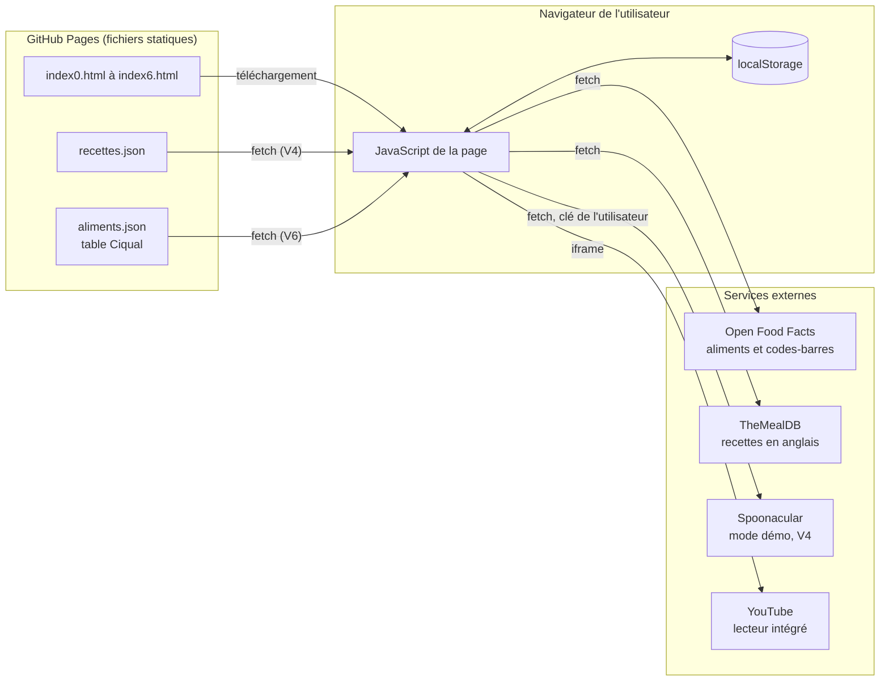
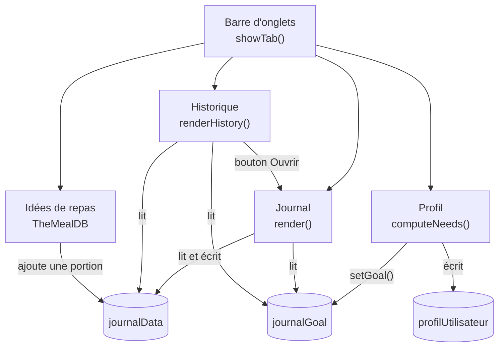
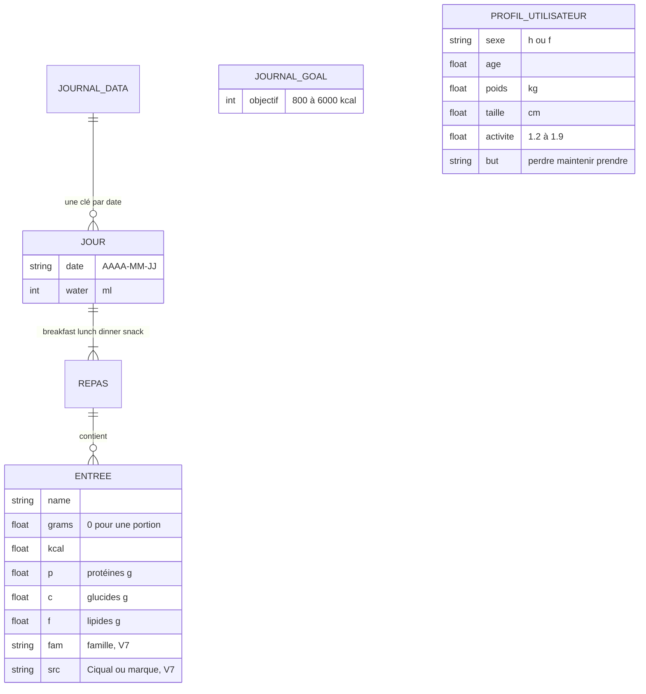
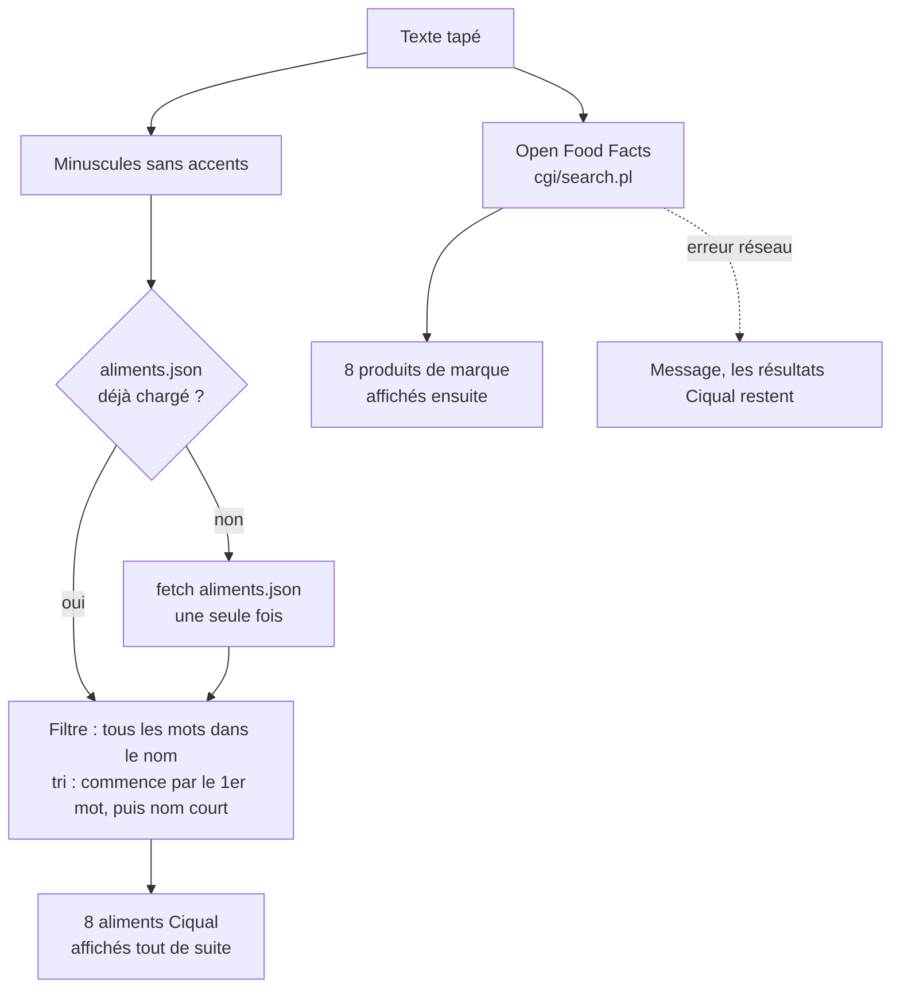
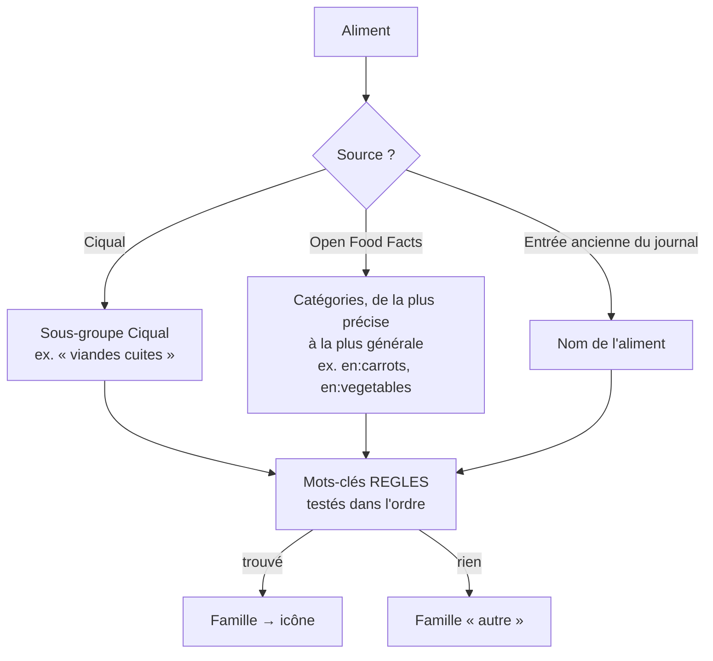
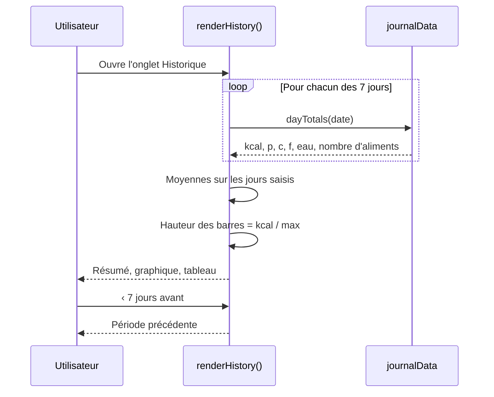

# Documentation technique

Retour à l'[accueil de la documentation](accueil.md). Pour lancer le projet : [installation.md](installation.md).

## Architecture générale

Le site est **statique** : des fichiers HTML (avec leur CSS et leur JavaScript intégrés) servis par GitHub Pages. Il n'y a ni serveur applicatif ni base de données : le navigateur appelle directement des API publiques et enregistre les données de l'utilisateur dans son `localStorage`.



Hors du site, deux scripts Python locaux préparent des données, sans jamais être exécutés par le site :

- `scripts/trouver_videos.py` interroge l'API YouTube Data pour ajouter une vidéo et une miniature à chaque recette de `recettes.json` ;
- `scripts/ciqual_vers_json.py` convertit la table Ciqual de l'ANSES (fichier Excel) en `aliments.json`.

## Fichiers du dépôt

| Fichier | Rôle |
|---|---|
| `index.html` | Accueil, liens vers toutes les versions |
| `index0.html` | V1 : recettes par ingrédients (TheMealDB), allergies, régime |
| `index1.html` | V2 : V1 + favoris et recommandations (`profilRecettes`) |
| `index2.html` | V3 : journal alimentaire |
| `index3.html` | V4 : recettes protéinées en français + mode Spoonacular |
| `index4.html` | V5 : journal + historique 7 jours + calcul des besoins |
| `index5.html` | V6 : V5 + recherche dans la table Ciqual |
| `index6.html` | V7 : V6 + icônes, tolérance aux fautes, graphisme retouché |
| `recettes.json` | Ingrédients (valeurs pour 100 g) et recettes de la V4 |
| `aliments.json` | Table Ciqual 2025 convertie : environ 3 300 aliments génériques (valeurs pour 100 g) |
| `grist-widget.html` | Vue personnalisée Grist chargée par URL (test du cours) |
| `scripts/trouver_videos.py` | Script local de remplissage des vidéos YouTube |
| `scripts/ciqual_vers_json.py` | Script local de conversion de la table Ciqual |
| `accueil.md`, `utilisateur.md`, `technique.md`, `installation.md` | Documentation |

Règle du projet : une nouvelle version = un nouveau fichier `indexN.html` ; les versions précédentes ne sont jamais modifiées.

## Organisation de `index4.html` (V5) à `index6.html` (V7)

La V6 reprend la V5 à l'identique, sauf la recherche d'aliments. La V7 reprend la V6 et ajoute les icônes, la correction des fautes et un nouveau style (voir plus bas). La page fonctionne avec quatre onglets (des `<section>` affichées ou masquées par `showTab()`).



| Fonction | Rôle |
|---|---|
| `render()` | Affiche le jour choisi : résumé, macros, eau, liste des repas |
| `calc(produit, grammes)` | Calcule kcal et macros à partir des valeurs pour 100 g d'Open Food Facts |
| `search()` / `byCode()` | Recherche d'un aliment par nom ou par code-barres |
| `chargerCiqual()` / `chercherCiqual(q)` | V6 : charge `aliments.json` au premier besoin et y cherche les aliments |
| `familleDe(aliment)` / `icone(famille)` | V7 : trouve la famille d'un aliment et renvoie son icône SVG |
| `corriger(q)` / `distance(a, b)` | V7 : corrige les fautes de frappe à partir des mots de la table Ciqual |
| `majJour()` / `decaler(n)` | V7 : flèches jour précédent / suivant |
| `renderHistory()` | Calcule et affiche le résumé, le graphique et le tableau des 7 jours |
| `dayTotals(clé)` | Totaux d'un jour, **sans créer d'entrée vide** dans le journal |
| `isoDate(date)` | Date locale au format `AAAA-MM-JJ`, le format des clés du journal |
| `computeNeeds(enregistrer)` | Calcule métabolisme, dépense, objectif conseillé et macros |
| `setGoal(valeur)` | Enregistre l'objectif dans `journalGoal` et met le journal à jour |
| `esc(texte)` | Échappe le HTML avant tout affichage d'une donnée externe |

## Modèle de données (localStorage)

Les pages `index2.html`, `index3.html` et `index4.html` partagent les mêmes clés : un aliment ajouté depuis les recettes apparaît dans le journal et dans l'historique.



Exemple de `journalData` :

```json
{
  "2026-11-03": {
    "meals": {
      "breakfast": [{"name": "Skyr nature", "grams": 150, "kcal": 90, "p": 15, "c": 6, "f": 0.3}],
      "lunch": [], "dinner": [], "snack": []
    },
    "water": 750
  }
}
```

| Clé | Écrite par | Contenu |
|---|---|---|
| `journalData` | V3, V4, V5 | Journal par date (voir ci-dessus) |
| `journalGoal` | V3, V5 | Objectif calorique (entier) |
| `profilUtilisateur` | V5 | Profil utilisé pour le calcul des besoins |
| `spoonKey` | V4 | Clé Spoonacular saisie par l'utilisateur |
| `profilRecettes` | V2 | Goûts (catégories et cuisines aimées) |

## Calculs

### Calories d'un aliment (Open Food Facts)

Valeurs pour 100 g multipliées par `grammes / 100`. Si `energy-kcal_100g` est absent, on convertit les kilojoules : `energy_100g / 4,184`.

### Recherche d'aliments (V6)



- Chaque aliment Ciqual est transformé en objet au même format qu'un produit Open Food Facts (`product_name`, `nutriments`) : `calc()`, `pick()` et l'ajout au journal fonctionnent sans modification.
- Un compteur (`rechercheNo`) empêche une réponse lente d'Open Food Facts d'écraser une recherche plus récente.
- Format compact de `aliments.json` (un tableau par aliment, environ 315 Ko) :

```json
{"colonnes": ["code", "nom", "groupe", "kcal", "p", "c", "f"],
 "aliments": [["20009", "Carotte, crue", "légumes", 30, 0.8, 5.2, 0.2]]}
```

- Conversion des valeurs Ciqual par le script : « traces » → 0, « < x » → x / 2, « - » → inconnu ; protéines « N × facteur de Jones », sinon « N × 6,25 » ; les aliments sans énergie sont ignorés.

### Icônes par famille (V7)

Douze familles (`legumes`, `fruits`, `viandes`, `poissons`, `oeufs`, `laitages`, `cereales`, `sucre`, `boissons`, `plats`, `matieres`, `autre`), chacune avec un tracé SVG et deux couleurs (`FAMILLES`). La famille est trouvée par mots-clés (`REGLES`, testées dans l'ordre) :



La famille (`fam`) et la source (`src`) sont enregistrées avec chaque nouvel aliment du journal ; les anciennes entrées sont devinées par leur nom.

### Fautes de frappe (V7)

- Seulement si Ciqual ne trouve rien : chaque mot inconnu (4 lettres ou plus, qui n'est pas le début d'un mot connu) est remplacé par le mot le plus proche du vocabulaire de la table Ciqual.
- Proximité mesurée par la distance de Damerau-Levenshtein (lettres ajoutées, supprimées, remplacées ou inversées) : 1 faute jusqu'à 6 lettres, 2 au-delà ; à égalité, le mot le plus fréquent gagne.
- Le texte corrigé est aussi envoyé à Open Food Facts. Le bouton « Chercher quand même » relance avec le texte tapé (`search(true)`).

### Historique sur 7 jours



- La fin de période (`histEnd`) vaut aujourd'hui ; les boutons la décalent de 7 jours.
- Un jour est « saisi » s'il contient au moins un aliment ; les moyennes ignorent les jours vides.
- Échelle du graphique : `max = max(objectif × 1,25 ; jour le plus haut)`, hauteur d'une barre en `%` de cette valeur. Le graphique est fait en HTML/CSS, sans bibliothèque.
- Accessibilité : le graphique a une description (`role="img"` et `aria-label`) et le tableau donne les mêmes chiffres.

### Besoins caloriques (formule de Mifflin-St Jeor)

- Métabolisme de base (MB) = 10 × poids (kg) + 6,25 × taille (cm) − 5 × âge (ans) + 5 (homme) ou − 161 (femme)
- Dépense quotidienne = MB × facteur d'activité (1,2 ; 1,375 ; 1,55 ; 1,725 ; 1,9)
- Objectif conseillé = dépense × 0,85 (perdre), × 1 (maintenir) ou × 1,1 (prendre du muscle), arrondi à 10 kcal et borné entre 800 et 6 000
- Protéines = 1,6 g par kg ; lipides = 30 % des calories (÷ 9) ; glucides = le reste (÷ 4)

Exemple : homme, 25 ans, 70 kg, 175 cm, activité modérée → MB = 1 674 kcal, dépense = 2 594 kcal, objectif « maintenir » = 2 590 kcal.

## Services externes

| Service | Utilisé par | Limites |
|---|---|---|
| [Table Ciqual, ANSES](https://ciqual.anses.fr/) | V6 (fichier `aliments.json`) | Aliments génériques, sans marques ; Licence Ouverte Etalab, source à citer |
| [Open Food Facts](https://openfoodfacts.github.io/openfoodfacts-server/api/) | V3, V5, V6 | Base collaborative (erreurs possibles), surtout des produits emballés |
| [TheMealDB](https://www.themealdb.com/api.php) | V1 à V3, V5 | En anglais, sans valeurs nutritionnelles |
| [Spoonacular](https://spoonacular.com/food-api) | V4 | Clé personnelle, quota gratuit limité, résultats en anglais |
| YouTube (lecteur `youtube-nocookie.com`) | V4 | Vidéos choisies par le script, à relire |
| YouTube Data API | script Python | Quota de 10 000 unités par jour, 100 par recherche |

## Règles de sécurité et de qualité

- **Aucune clé d'API dans le code ni dans le dépôt** : la clé Spoonacular est saisie par l'utilisateur, la clé YouTube passe par une variable d'environnement.
- Toute chaîne venant d'une API est échappée avec `esc()` avant `innerHTML`.
- Champs de données sans espaces ni accents (consigne du cours, évite les `undefined`).
- Les nutriments et les besoins sont des estimations indicatives.

## Limites connues

- Données liées à un seul navigateur, sans compte ni synchronisation.
- Valeurs des ingrédients de `recettes.json` approximatives, à vérifier avec la table Ciqual de l'ANSES.
- Pas de scan de code-barres par la caméra (code saisi à la main).
- Aucun test automatique : les tests sont faits à la main dans le navigateur.
