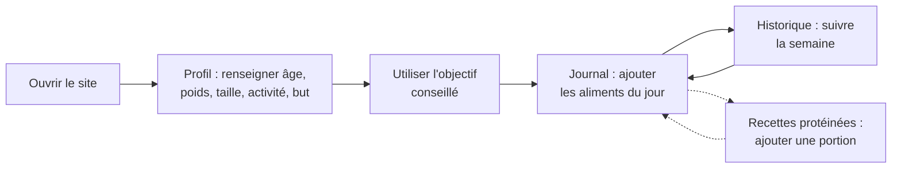
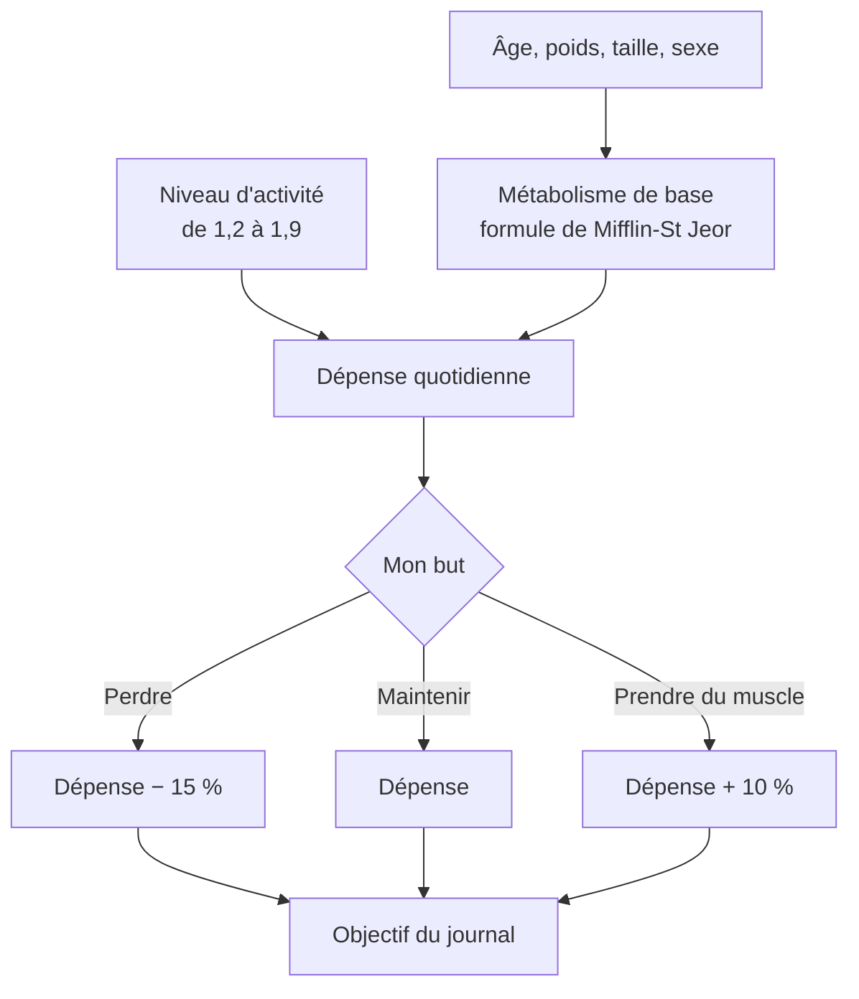
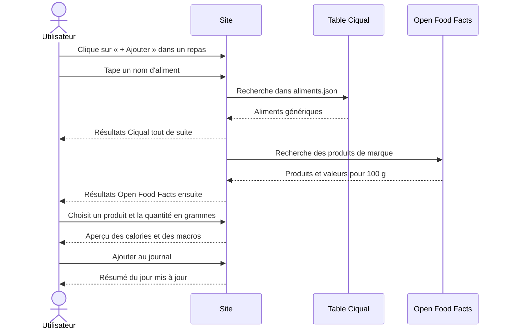

# Guide utilisateur

Ce guide explique comment utiliser la version actuelle du site (V7, `index6.html`) et la page des recettes protéinées (`index3.html`).

Retour à l'[accueil de la documentation](accueil.md).

## Parcours général

## 1. Renseigner son profil et calculer ses besoins

Onglet **Profil** :

1. Choisis ton sexe (utilisé par la formule de calcul), puis indique ton âge, ton poids, ta taille et ton niveau d'activité.
2. Choisis ton but : perdre du poids, maintenir ou prendre du muscle.
3. Le bloc **Mes besoins estimés** se met à jour tout seul :
   - **Métabolisme de base** : énergie dépensée au repos ;
   - **Dépense quotidienne** : métabolisme × niveau d'activité ;
   - **Objectif conseillé** : la dépense, −15 % pour perdre du poids ou +10 % pour prendre du muscle ;
   - une répartition indicative des protéines, lipides et glucides.
4. Clique sur **Utiliser comme objectif du journal** pour que le journal compare tes repas à cette valeur.

Tu peux aussi saisir un objectif à la main (entre 800 et 6 000 kcal) dans le cadre **Objectif de calories par jour**. La section « Comment c'est calculé ? » détaille le calcul avec tes valeurs.

## 2. Tenir son journal

Onglet **Journal** :

1. Choisis le jour avec les flèches ‹ › ou le calendrier (aujourd'hui par défaut, pas de jour dans le futur).
2. Dans un repas (petit-déjeuner, déjeuner, dîner, collations), clique sur **+ Ajouter**.
3. Cherche un aliment par son nom (ex. « carotte crue », « donut ») ou saisis son code-barres (les chiffres sous le code-barres de l'emballage). Les résultats arrivent en deux groupes :
   - **Aliments génériques (Ciqual, ANSES)** : valeurs moyennes officielles d'un type d'aliment (« Carotte, crue », « Riz blanc, cuit »). Idéal pour les aliments bruts et le fait maison.
   - **Produits de marque (Open Food Facts)** : produits de supermarché précis (une marque, un distributeur). Le code-barres cherche uniquement dans ce groupe.

   Les accents et majuscules n'ont pas d'importance, et tous les mots tapés doivent figurer dans le nom (« poulet cuit »).

   **Fautes de frappe** : si rien n'est trouvé, le site corrige automatiquement (« carrote » → « carotte », « frommage » → « fromage ») et l'indique dans un bandeau jaune. Le lien **Chercher quand même** relance la recherche avec le mot tapé.

   Chaque résultat a une **icône de sa famille** (légumes, fruits, viandes, poissons, œufs, laitages, céréales, sucré, boissons, plats, matières grasses, autre).
4. Choisis un résultat, indique la quantité en grammes (ou clique sur 50, 100 ou 150 g) : un aperçu des calories et des macros s'affiche.
5. Clique sur **Ajouter au journal**.

Le résumé du jour affiche les calories consommées par rapport à l'objectif, ce qui reste (ou le dépassement), une barre de progression, les macros en grammes et en pourcentage, et l'eau bue (boutons −250 / +250 ml). Chaque aliment du journal garde son icône, sa quantité et sa source (Ciqual ou la marque). La croix supprime un aliment.

> Si Open Food Facts ne répond pas, les résultats Ciqual restent affichés. Open Food Facts est une base collaborative : un produit peut manquer ou avoir des valeurs incomplètes.

## 3. Suivre la semaine

Onglet **Historique** :

- Le titre indique la période affichée : les 7 derniers jours par défaut. Les boutons **‹ 7 jours avant** et **7 jours après ›** permettent de changer de période (on ne peut pas dépasser aujourd'hui).
- Le résumé donne, pour les jours où tu as saisi quelque chose, la moyenne des calories, le nombre de jours sous l'objectif, la moyenne de protéines et d'eau.
- Le graphique montre les calories de chaque jour :
  - barre verte : sous l'objectif ;
  - barre orange : au-dessus de l'objectif ;
  - trait pointillé horizontal : l'objectif ;
  - petit cadre pointillé : pas de saisie ce jour-là.
- Le tableau détaille chaque jour (calories, écart à l'objectif, protéines, glucides, lipides, eau). Le bouton **Ouvrir** affiche le journal de ce jour pour le compléter.

## 4. Trouver des idées de repas

- Onglet **Idées de repas** : indique des ingrédients séparés par des virgules (ex. « poulet, riz ») pour obtenir des recettes de la base TheMealDB (en anglais, sans valeurs nutritionnelles : tu saisis les calories de ta portion).
- Page **Recettes protéinées** (`index3.html`, lien en haut de la page) : 12 recettes françaises avec calories et macros calculées. Filtre par type (repas, collation sucrée, collation salée), par protéines minimales, ou cherche un ingrédient. Le bouton **Ajouter 1 portion** l'ajoute au journal avec ses vraies valeurs.

## 5. Où sont mes données ?

Tout est enregistré **dans ton navigateur** (localStorage) : il n'y a pas de compte. Conséquences :

- tes données ne passent pas d'un ordinateur ou d'un navigateur à l'autre ;
- vider les données du site dans le navigateur efface le journal ;
- le bouton **Effacer toutes mes données** (onglet Profil) vide le journal.

## Questions fréquentes

| Problème | Solution |
|---|---|
| « Erreur de connexion à Open Food Facts » | Vérifie ta connexion, puis réessaie : le service public est parfois lent ou indisponible. |
| Un produit n'a pas de calories | Il n'est pas affiché : la fiche Open Food Facts est incomplète. Essaie un autre produit. |
| Le bouton « Utiliser comme objectif » est grisé | Une valeur du profil est hors limites (âge 15–100 ans, poids 30–300 kg, taille 120–230 cm). |
| Mon historique est vide | Les données sont propres à chaque navigateur : utilise celui où tu as rempli ton journal. |

Les valeurs affichées sont des **estimations indicatives**, pas un avis médical ni diététique.
